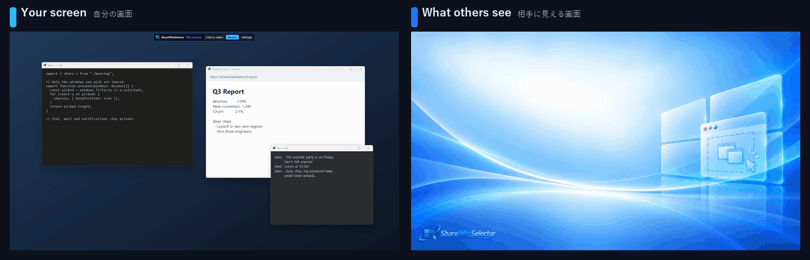

<p align="center">
  
</p>

<p align="center">
  <b>Share <i>Win</i>dows — and <i>win</i> your meetings.</b><br>
  選んだウィンドウだけを、画面上の位置のまま見せる。
</p>

<p align="center">
  <a href="README.md">English</a> | 日本語
</p>

<p align="center">
  
</p>

<p align="center">
  <a href="https://github.com/caronyan-gh/ShareWinSelector/releases/latest"><b>⬇ 最新版をダウンロード</b></a><br>
  迷ったら、開いた先の「Assets」にある <code>ShareWinSelector-SelfContained.exe</code> を。そのまま動きます。
</p>

---

Teams など、オンライン会議の画面共有は、たいてい「**ウィンドウ 1 つ**」か「**画面全体**」の二択です。
ウィンドウ共有だと、IDE とブラウザを行き来するたびに共有し直し。
画面全体だと、チャットの通知もメールのプレビューも、デスクトップのファイル名まで全部見えてしまいます。

**ShareWinSelector** はその間を埋めます。共有したいウィンドウをいくつでも選ぶと、
**実際の位置・重なり順のまま** 1 枚の「共有用出力」ウィンドウに合成します。
共有するのはその 1 枚だけで、アプリの操作はいつも通りです。

## 特長

- **選んだウィンドウだけが見える** — 実際の位置・サイズ・重なり順のまま。それ以外は背景になります。
- **操作はいつも通り** — 仮想カメラも特別なモードも不要。元のウィンドウをそのまま操作します。
- **通知やチャットは映らない** — 選んでいなければ、上に重なっても共有映像には出ません。
- **選んだアプリのメニューやダイアログは映る** — 右クリックメニュー・ダイアログ・ツールチップも自動で含めます。
- **共有したままモニターを切り替え** — 「共有するモニター」を変えるだけで、相手の画面もそのモニターに切り替わります。会議ソフトで共有し直す必要はありません。コンパクト表示でも、モニターの番号のボタン（1〜4）でワンクリックで切り替えられます（5 枚目以降のモニターは通常表示で選びます）。
- **モニターごとに分かる** — 一覧は共有するモニターにあるウィンドウが上に並び、ほかのモニターのものは「── DISPLAY2 ──」の区切り線の下に薄く表示されます。ほかのモニターへ動かした選択中のウィンドウは相手には見えないので、くすんだ水色の枠で区別します。
- **まとめて最前面 / 全部外す** — 共有するモニターにある共有中のウィンドウを、重なり順のまま一度に手前へ（相手の画面はちらつきません）。全部外したときは、数秒間「元に戻す」でクロップごと共有し直せます。
- **一時停止** — 選んだまま、相手には背景だけを映します。もう一度押すと、すぐ元どおりに映ります。ボタンは一覧の見出し・コンパクト表示・ツールバーにあり、一時停止中はツールバーに「⏸ 一時停止中」と出ます。
- **リモート連携（実験的）** — 同じ LAN にある別の PC（リモート デスクトップでつないでいる PC など）の画面を、「共有するモニター」の 1 枚（R）として共有できます。その PC のウィンドウも、この PC の一覧から選べます。
- **上をクロップ** — ブラウザのタブ名やアドレスバーを隠せます。クロップ量はアプリごとに保存（PWA はブラウザ本体と別扱い）。
- **共有前に確認** — 選んだウィンドウは、画面上で確認するまで相手に見せません（違うウィンドウを映す事故の防止）。
- **自分にだけ見えるオーバーレイ** — 共有中ウィンドウの強調枠、ツールバー、クリックで選ぶ選択モード。どれも共有映像には映りません。ツールバーはしばらく触らないと小さくたたみ、「n 個共有中」にカーソルを乗せると広がります。
- 相手からの見え方の**ライブプレビュー**、サムネイル／一覧表示、コンパクト表示、常に手前。
- 何もない部分の**背景**: 好きな単色（ドラッグで色を選ぶ）・標準の壁紙・好きな画像から選択。
- **止まりにくい** — GPU のリセット、モニター構成の変更、ウィンドウを閉じたとき・ハンドルの使い回しにも対応。
- ダークテーマ、日本語 / 英語。

## 動作環境

- Windows 10 バージョン 2004 以降、または Windows 11（64 ビット）
- 標準版を使う場合: [.NET 10 デスクトップ ランタイム](https://dotnet.microsoft.com/download/dotnet/10.0)（入っていなければ起動時に Windows が案内します）

## ダウンロード

[Releases](../../releases/latest) から最新版を取得してください。

| ファイル | サイズ | 説明 |
|---|---|---|
| `ShareWinSelector.exe` | 約 30 MB | 標準版。ファイル 1 つで、展開も不要。.NET 10 デスクトップ ランタイムが必要です。 |
| `ShareWinSelector-SelfContained.exe` | 約 70 MB | ランタイム不要。初回起動時に WPF のネイティブ DLL 数個を一時フォルダへ展開します。 |
| `SHA256SUMS.txt` | | 上のファイルのハッシュ。 |

インストーラーはありません。exe をそのまま実行してください。設定は `%LOCALAPPDATA%\ShareWinSelector\` に保存されます。
消すときは、設定の一番下の **「設定を削除して終了」** を押してから exe を削除してください。何も残りません。

exe はコード署名していないため、初回起動時に Windows SmartScreen が「**Windows によって PC が保護されました**」と表示することがあります。
「**詳細情報**」→「**実行**」で起動できます。リリース版は、タグを付けたソースから [GitHub Actions](.github/workflows/release.yml) でビルドしています。

## 使い方

1. **ShareWinSelector** を起動し、共有する**モニター**を選びます。
2. 見せたいウィンドウにチェックを入れます（サムネイル／一覧から、またはツールバーの「**クリックで選択**」で画面上をクリック）。
3. Teams などで、**`🖥️ ShareWinSelector - 共有用出力`** という名前のウィンドウを**ウィンドウ共有**します。
4. あとはいつも通り作業するだけ。相手には、チェックしたウィンドウだけがその位置に見えます。

**出力ウィンドウの置き場所**（設定 →「出力ウィンドウの配置」）

- **最背面**（既定）— いちばん後ろに置きます。手前のウィンドウをどかすと、相手からの見え方を確認できます。
- **通常** — 普通のウィンドウ。どこをつかんでも移動でき、ダブルクリックでモニター全体に最大化します。
- **画面外** — すべてのモニターの外に、モニターと同じ解像度で置きます。自分からは見えません（メイン画面のプレビューで確認できます）。
  - Teams では画面外のままで共有できます。
  - **Zoom では画面外にすると共有が一時停止します**（画面内に戻すと再開します）。Zoom 側の仕様なので、Zoom では「最背面」か「通常」を使ってください。
  - そのほかの会議ソフト（Google Meet、Webex、Discord など）は未確認です。共有が止まる・映らないときは、同じように「最背面」か「通常」に切り替えてください。
- 出力ウィンドウを**右クリック**すると、全画面（枠なし）、モニターの 75% / 50% / 33%、1920 × 1080 などのよくある大きさを選べます（画面外のときを除く）。
- 出力ウィンドウでデスクトップのアイコンが隠れたときは、管理画面の上の**デスクトップ**ボタンで、エクスプローラーのデスクトップを開けます。

**上をクロップ**（ブラウザのタブ名を隠すなど）

- 一覧の上の「**上をクロップ**」をオンにすると、選んだときに最初からクロップします。行ごとの「**クロップ**」で個別に切り替えることもできます。
- そのアプリのクロップが未保存なら、相手に見せないまま、オーバーレイで上辺を下へドラッグして範囲を決めます。「**確定**」（Enter）で共有が始まります。
- 「クリックで選択」中に **Ctrl＋クリック** すると、そのウィンドウの上辺を調整してから共有します。共有中のウィンドウなら、クロップ範囲を決め直せます。
- クロップ量はアプリごとに保存され、各アプリでクロップするかどうかも再起動後まで覚えています。まだ保存していないアプリは、行の「クロップ」が押せません。

**共有前に確認**

- 「**共有前に確認**」をオンにすると、選んだウィンドウはオーバーレイの「**共有する**」を押すまで相手に見せません。何枚か続けて選んだときは、1 枚ずつ順番に確認します。

**リモート デスクトップ（RDP）の中で使うとき**

- 環境によっては、右クリック メニューなどを閉じたときに、Windows 側の取り込みの後片付けが終わらないことがあります。共有はそのまま続きますが、メニューなどを何百回も開け閉めすると、メニューなどが相手に映らなくなります。ShareWinSelector を起動し直すと戻ります。

**リモート連携（実験的な機能）**

リモート デスクトップ（RDP）でつないでいる PC など、別の PC（**子**）の画面を、会議で共有している PC（**親**）の「共有するモニター」の 1 枚（**R**）として共有できます。
会議ソフトで共有するのは、いつもどおり親の `🖥️ ShareWinSelector - 共有用出力` だけです。

- 同じ LAN（同じセグメント）の中で使う前提です。VPN 越し・インターネット越しは想定していません。
- **始め方**: 両方の PC で ShareWinSelector を起動し、設定の「**特殊設定**」で「**リモート連携を使う**」をオンにします。
  - 会議の画面共有をする PC は「**親**」、画面を送る PC は「**子**」を選びます。
  - 子では「**親を見つける**」で親を選ぶか、親の IP アドレスを入れて「**つなぐ**」を押します。ポートは親と子で同じにしてください（既定は 47810）。
- **ペアリング**: 初めてつなぐときは、親と子の両方に 6 桁の番号が出ます。両方の画面で同じ番号なのを確かめてから、両方で「**許可**」を押してください。
  - 次からは番号の確認なしでつながります。
  - 2 回目からは、子でつなぐ前に「親「○○」につなぎますか？」と聞きます（［**つなぐ**］［**ペアリングを解除**］［**キャンセル**］）。
    「この親には確認せずにつなぐ」を付けると、次からは聞きません。特殊設定の［つなぐ］からつないだときは聞きません。［キャンセル］すると、［つなぐ］を押すか起動し直すまで、子からはつなぎません。
  - どちらかで「**ペアリングを解除**」すると、つながっていれば相手にも伝わり、相手もペアリングを解除します。解除したあと、子からはつなぎ直しません（次に［つなぐ］を押したときに、番号の確認からやり直します）。
  - 通信は暗号化しています。
- **子の画面を共有する**: つながると、親の「共有するモニター」に **R** が増えます。R を選ぶと、子で共有しているウィンドウが、子の画面の位置のまま相手に見えます。
  - 親と子のウィンドウを 1 枚に混ぜることはしません。R も、モニターの 1 枚として切り替えます。
  - 子として動いている間、子の出力ウィンドウは自動で画面外に置かれます。
- **親から子のウィンドウを選ぶ**: 子のウィンドウは、親の一覧にも「── R 子の名前 ──」の下に並びます。チェックすると、子で共有が始まります。
  - サムネイル表示では、子のウィンドウの静止画も数秒おきに届きます。
  - 親の「全部外す」「元に戻す」は、子のウィンドウにも効きます。
  - 親の「共有前に確認」がオンなら、カーソルのそばで確認します。
  - クロップは、親か子の「上をクロップ」のどちらかがオンなら効きます。子でそのアプリのクロップ範囲がまだ保存されていなければ、子の画面で範囲を決める必要があります。そのときは、親のカーソルのそばとステータス行で知らせます。
  - 子の特殊設定の「**親にこの PC のウィンドウの一覧を送る**」をオフにすると、ウィンドウの一覧とサムネイルを親に送らず、親からの共有の切り替えも受け付けません。
- **つながりの札**: 「相手からの見え方」の横（コンパクト表示ではプレビューの上）に、今の状態を出します。
  - 子: 赤「● 親へ送信中」／黄「親へ接続中…」
  - 親: 赤「● R を共有中」／水色「● 子と接続中」／黄「子の確認待ち…」
- **ファイアウォール**: 初めて使うとき、Windows のファイアウォールの確認画面が出ることがあります。つなぐには許可が必要です。
  - そのとき追加した許可は、リモート連携を使うのをやめても残ります。不要になったら「Windows ファイアウォールを介したアプリを許可」から ShareWinSelector を外してください。
- **RDP の中で子を動かすとき**: カーソルを RDP の画面に入れたあと、1 回クリックするまでカーソルが出ない（入力が届かない）ことがあります。RDP の中で画面を取り込むアプリ（Snipping Tool など）でも起こる、Windows / RDP 側の動きです。
- 会議ソフトで共有しながら RDP を操作すると、重く感じることがあります（主に会議ソフト側の処理の重さです）。

## ソースからビルド

```
dotnet build src/ShareWinSelector
```

ファイル 1 つの exe を作る（`src/ShareWinSelector/bin/publish/` に出力）:

```
dotnet publish src/ShareWinSelector -p:PublishProfile=FrameworkDependent
dotnet publish src/ShareWinSelector -p:PublishProfile=SelfContained
```

.NET 10 / WPF、`Windows.Graphics.Capture`、[Vortice.Windows](https://github.com/amerkoleci/Vortice.Windows) による Direct3D 11 + Direct2D で作っています。

> [!NOTE]
> **Debug** ビルドでは、メイン画面・オーバーレイ・ツールバーをキャプチャから**除外しません**（スクリーンショットで確認できるように。
> タイトルに `(Debug - capturable)` と表示されます）。実際の会議では必ず Release ビルドを使ってください。

## ライセンス

[MIT](LICENSE)
